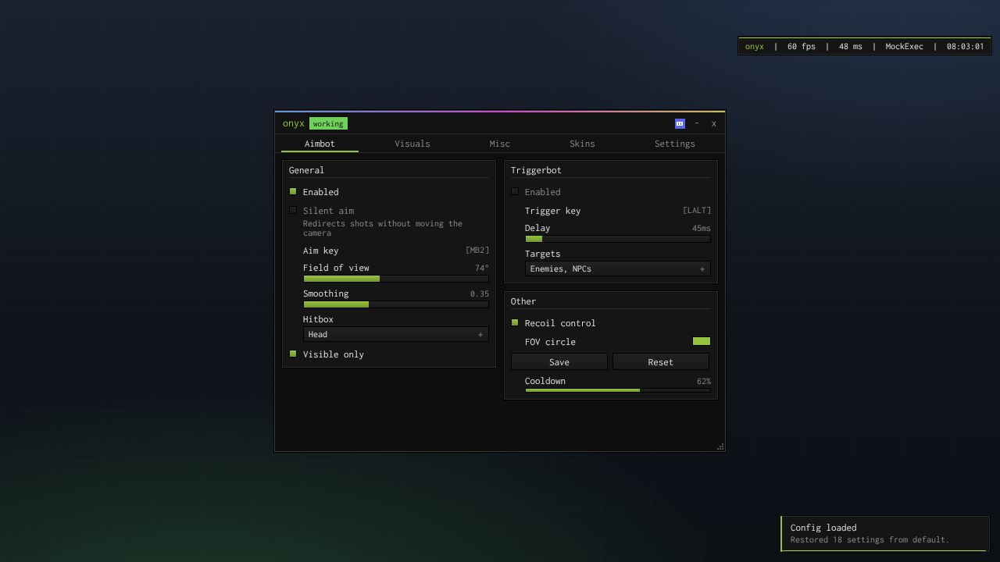
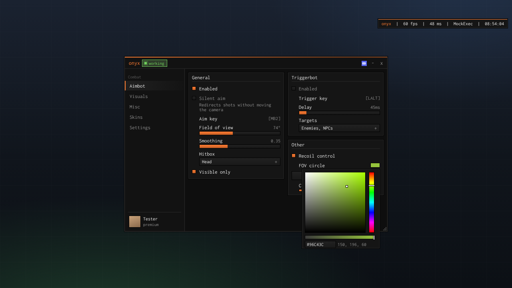
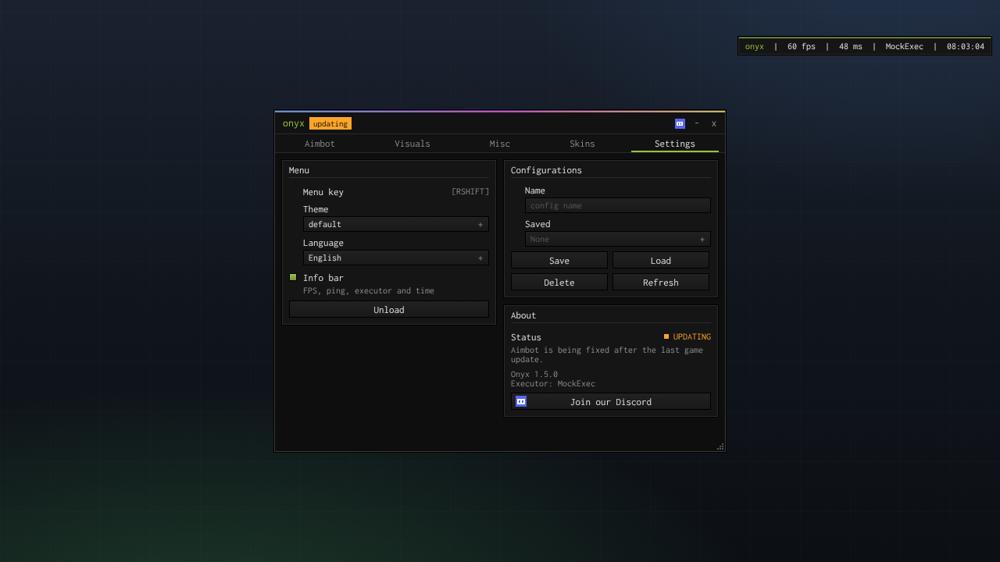
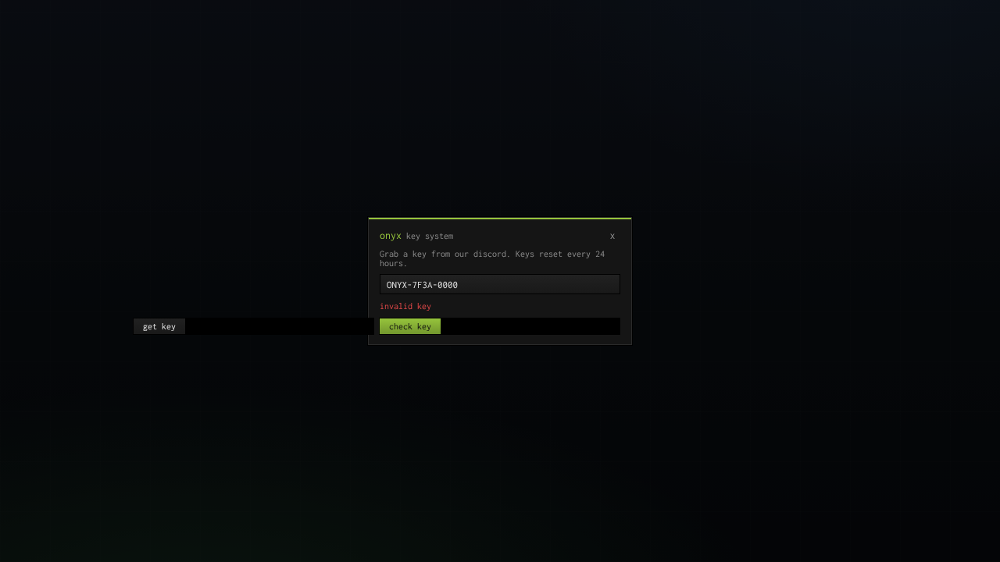
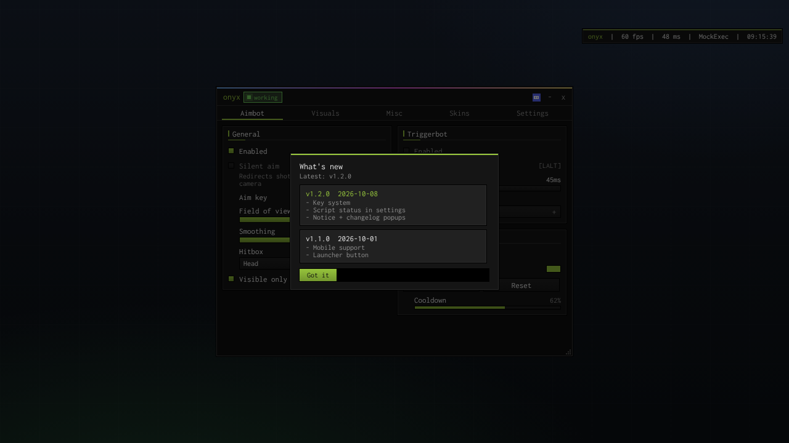
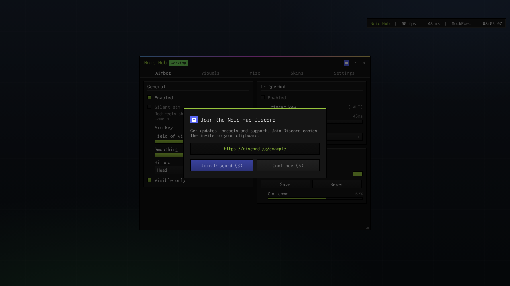
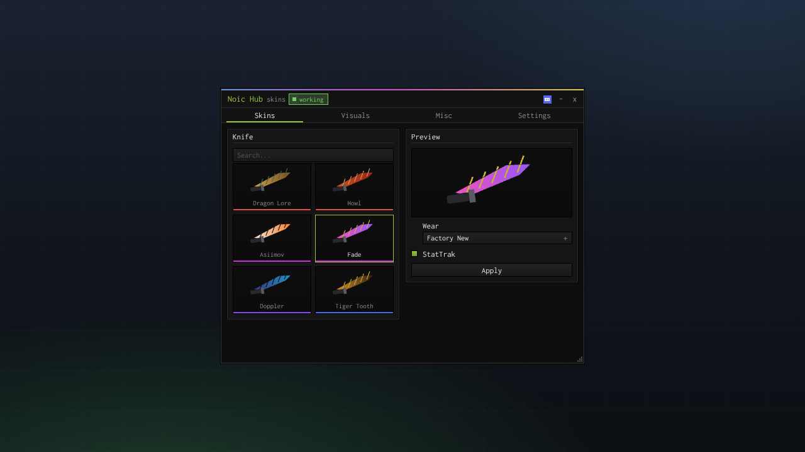
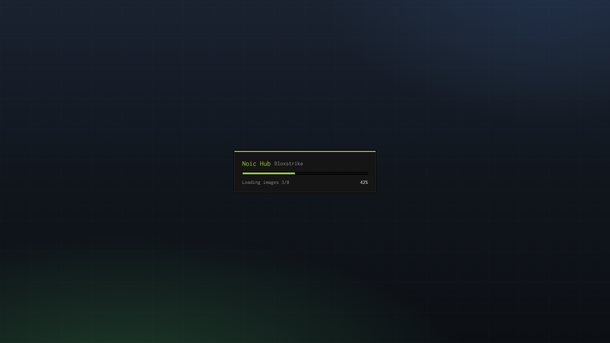
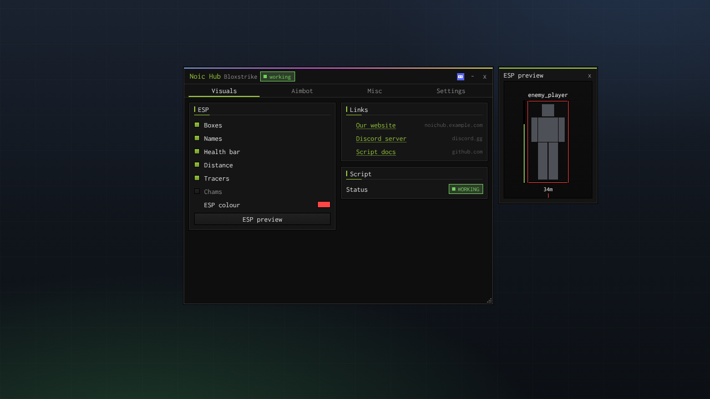
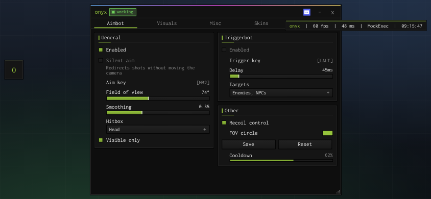

# onyx

A Roblox UI library styled after old CS cheat menus. Black pixel borders, rainbow bar on top, two-column group boxes, monospace everything. Works on PC and mobile.



```lua
local Onyx = loadstring(game:HttpGet("https://raw.githubusercontent.com/onyxuilibrary/onyx-ui/main/source.lua"))()
```

## Example

```lua
local Onyx = loadstring(game:HttpGet("https://raw.githubusercontent.com/onyxuilibrary/onyx-ui/main/source.lua"))()

local window = Onyx:CreateWindow({
	name = "onyx",
	subtitle = "my hub",
	status = "working",
	configuration = { fileName = "my-hub" },
})

local tab = window:CreateTab({ name = "Aimbot" })
local general = tab:CreateSection("General")

general:CreateToggle({
	name = "Enabled",
	callback = function(on)
		print("enabled:", on)
	end,
})

general:CreateSlider({
	name = "Field of view",
	range = { 0, 180 },
	value = 90,
	suffix = "°",
	callback = function(value)
		print("fov:", value)
	end,
})
```

RightShift opens and closes the menu on PC. On mobile there's a small button on the side of the screen you can tap (and drag out of the way).

There's a bigger example covering everything in [example.lua](example.lua).

## Script status (working / updating / patched)

Lets your users see if the script works right now. It shows as a coloured tag next to the title and in the Settings tab.

- `working` (green): everything works
- `updating` (orange): game updated, you're fixing it
- `patched` (red): doesn't work right now

The best way is a text file on GitHub, so you can change it without re-uploading your script:

1. Make a file called `status.txt` in your repo with just the word `working` in it
2. Open it, click **Raw**, copy the link (it starts with `raw.githubusercontent.com`)
3. Add it to your window:

```lua
local window = Onyx:CreateWindow({
	name = "my hub",
	status = "working", -- fallback if the file can't be loaded
	statusUrl = "https://raw.githubusercontent.com/YOUR-NAME/YOUR-REPO/main/status.txt",
})
```

When the game breaks your script, edit the file to say `patched`. You can add a note too: `updating: fixing aimbot`. If you made your own settings tab, `section:CreateStatus()` adds the status row to it.

Full guide with every option and fixes for common problems: [docs/status.md](docs/status.md)

## Custom colours

Players choose colours themselves with colour pickers:

- **Accent colour** in the Settings tab: players pick the menu's own colour (toggles, sliders, tabs, title). It's saved with their config. Picking a theme moves it to that theme's colour.
- **Your colour pickers**: add one for anything in your script, like ESP or chams. Click the swatch for a colour square, hue bar, see-through bar and a hex box.

```lua
section:CreateColorPicker({
	name = "ESP colour",
	flag = "EspColour",                    -- saved with configs
	color = Color3.fromRGB(255, 70, 70),   -- starting colour
	callback = function(color) end,
})
window:SetAccent(Color3.fromRGB(255, 120, 40))   -- set the menu colour from your script
```

Everything about colours: [docs/colors.md](docs/colors.md)

## What's in it

- toggles, buttons, sliders, dropdowns (multi select + search), inputs, keybinds (with hold mode), colour pickers, stats, progress bars, consoles, text and dividers
- group boxes that fill two columns, row/column groups for putting things side by side
- top tabs or a sidebar with your avatar
- config saving with autosave/autoload and named configs
- 6 themes plus custom ones, all switchable live
- key system
- script status (working / updating / patched) as a badge with a pulsing dot in the header and settings. Point it at a text file and you can flip it to patched without updating your script, see [status](docs/status.md)
- notice and changelog popups when the script runs
- info bar with fps, ping, executor and the time
- discord button with the discord logo (copies the invite and opens it in discord)
- "join our discord" prompt with countdown buttons
- language picker in settings, 10 languages built in, add your own
- loading screen ("Authenticating...", "Loading features...") and a smooth entrance animation after it
- custom colours: colour pickers for your features, and players pick the menu's accent colour in Settings, see [colours](docs/colors.md)
- ESP preview panel with a dummy player that follows your ESP toggles and colours, see [ESP preview](docs/esp-preview.md)
- links (accent, underlined, click to copy)
- images and image galleries (skin pickers), with web links downloaded and cached for you
- open/close animations, and a small draggable button to open the menu on mobile (Delta etc.)
- notifications, toasts and popups
- a settings tab with menu key, theme, configs and unload built in
- mobile: launcher button, scales to fit the screen, multi-touch safe sliders

## Screenshots

| | |
|---|---|
|  |  |
| sidebar layout, ember theme, colour picker | settings tab with script status |
|  |  |
| key system | changelog on execute |
|  |  |
| discord prompt with countdown buttons | image gallery for skins (placeholder pictures) |
|  |  |
| loading screen | ESP preview, links and the status badge |



*phone in landscape, the `onyx` button on the left toggles the menu*

These are rendered from the library's real layout using the test runtime in `tests/`, so spacing and colours match. In game the text is drawn by Roblox, so it can look a tiny bit different.

## Docs

- [Getting started](docs/getting-started.md)
- [Window](docs/window.md)
- [Tabs, sections and groups](docs/layout.md)
- [Elements](docs/elements.md)
- [Notifications, popups, notice and changelog](docs/messages.md)
- [Key system](docs/key-system.md)
- [Script status](docs/status.md)
- [Saving and flags](docs/saving.md)
- [Themes](docs/themes.md)
- [Mobile](docs/mobile.md)

## Tests

`tests/` has a mock of the Roblox engine. It's strict, so a bad property name, wrong value type or invalid enum errors the same way it would in game. The suite clicks, drags, types and taps through every element, about 380 checks.

```
cd tests
npm install
npm test
```

## License

MIT
